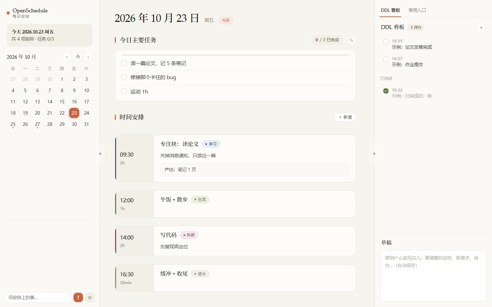
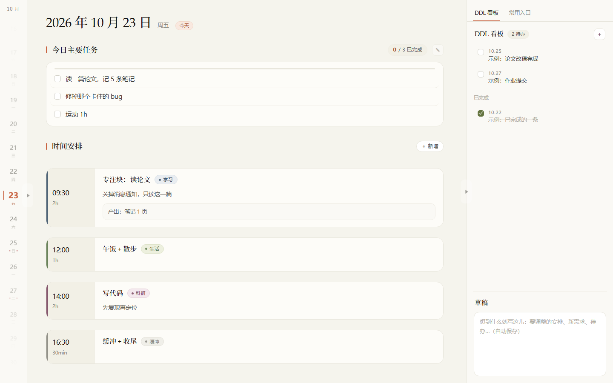

# OpenSchedule · 每日安排

一个**单文件、离线可用**的日程应用：左边月历，中间当天时间线，右边 DDL 看板 + 常用入口 + 草稿。



左栏收起后是「歌词式」竖排日号：滚动即换日，当前日居中、上下渐隐，有截止的日子在星期两侧带红点。



## 30 秒上手

**只想看看**：直接用浏览器打开 `docs/example.html`。这是脱敏示例，不需要装任何东西，也不需要联网。

**想用自己的数据**：

```bash
cp -r examples data          # Windows: xcopy examples data /E /I
# 编辑 data/schedule.json、data/todo.md、data/links.json
python build/build.py        # 产物：dist/OpenSchedule.html，双击即用
```

> 没有 `data/` 也能构建——会自动退到 `examples/` 生成示例版。

**想要 DDL 直接和文件同步、以及左栏助手**：再跑 `python serve.py`，页面会开在 `http://127.0.0.1:8123/`。

只依赖 **Python 3.8+ 标准库**；只有换图标时才需要 `Pillow`。

## 功能

| 区域 | 能力 |
|---|---|
| 左栏 | 月历（点击跳转）、今天回中、前后翻月、有安排的日浅灰、有截止的在数字下加红点；可收起成竖排日号：滚轮滑动即换日，当前日居中放大、上下渐隐，左侧一条与日期同高的赤陶竖条；顶部显示所在月份 |
| 中间 | 「今日主要任务」可编辑、点一下即勾选完成，上方进度条随之增长；「时间安排」按时间块展示，含类型色标、说明、子项、产出、资料链接；hover 出现 ＋ 插入 |
| 类型 | 四种：**学习 / 生活 / 科研 / 缓冲** |
| 右栏 | 上下两栏、分隔条可拖：上栏是 **DDL 看板 / 常用入口**，下栏是**草稿**（自动保存） |
| DDL 看板 | 勾选、新增、✎ 改名、× 删除；用 `serve.py` 打开时**直接读写 `data/todo.md`** |
| 常用入口 | 悬停 ✎ 改 / × 删、右上 ＋ 新增 |
| 侧栏 | 左右都能拖拽调宽（左 212–470px，右 220–560px）；收起按钮是边缘一个实心三角小胶囊，平时很淡 |
| 助手 | 左栏底部的聊天框，⚙ 里可配置**多个模型**随时切换；服务端会把今天的任务 / 时间表 / 未完成 DDL 拼进上下文 |
| 资料链接 | 类型（PDF / DOCX / 文件夹 / 网页…）按路径自动识别，可选择系统应用或浏览器打开 |

## 目录结构

```
Schedule/
├─ frontend/              通用前端
│  ├─ index.html
│  └─ assets/{app.css, app.js}
├─ build/
│  ├─ build.py            frontend/ + data/ → 单文件 HTML
│  └─ make_icon.py        app-icon.png → app-icon.ico（10 个尺寸）
├─ serve.py               本地服务：页面托管 + todo.md 同步 + 助手
├─ examples/              脱敏示例数据（随仓库公开）
├─ docs/                  示例产物与截图
├─ data/                  ← 你的个人数据（已 gitignore）
├─ dist/                  构建产物（已 gitignore）
├─ app-icon.png / .ico    图标源文件与多尺寸版本
└─ README.md
```

## 数据格式

`data/schedule.json`：

```json
{
  "2026-10-23": {
    "tasks": [{ "text": "写论文", "link": "DOCX" }],
    "items": [
      { "t": "20:00", "title": "论文修改", "type": "research", "d": "2h",
        "detail": "改两节", "out": "定稿", "links": ["DOCX"] }
    ]
  }
}
```

- `tasks` = 今日主要任务（一句话一条）；`items` = 具体时间块。
- `links` 里写 `links.json → paths` 的 key，前端自动解析成完整链接。
- `type` 取值：`study` 学习 / `life` 生活 / `research` 科研 / `rest` 缓冲。老文件里的 `class`、`must`、`gold`、`push`、`meet`、`red` 会自动映射（class/must→study，gold/push/meet/red→research）。

`data/todo.md`（DDL 的数据源）：

```markdown
- [ ] 10.25 论文改稿完成
- [x] 10.19 课程作业提交
- [ ] 2027.1.4 论文投稿
```

`data/links.json`：

```json
{
  "todo": "D:/path/to/todo.md",
  "paths": { "DOCX": { "path": "D:/.../论文.docx", "label": "论文 docx", "short": "论文" } },
  "sidebar": [{ "icon": "📄", "label": "论文 docx", "key": "DOCX" }],
  "quick": ["DOCX"]
}
```

## License

MIT
